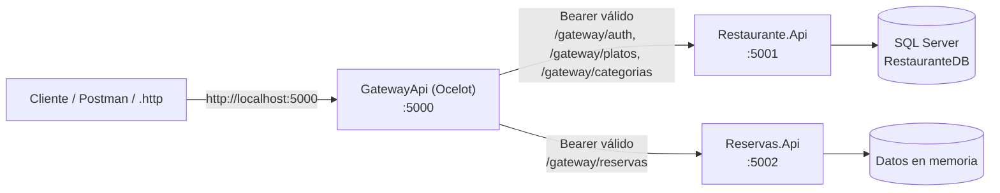

# Laboratorio 15 — Microservicios con API Gateway y Ocelot

Solución local del laboratorio de **Microservicios con API Gateway y Ocelot**. El cliente
solo conoce el gateway (`http://localhost:5000`); el gateway enruta a la API en capas de la
semana 14 y a un segundo microservicio de reservas.

## Arquitectura



| Componente | Puerto | Rol |
| :--- | :--- | :--- |
| `GatewayApi` | **5000** | Único punto de entrada. Ocelot enruta y valida el JWT en las rutas protegidas. |
| `Restaurante.Api` | **5001** | Microservicio 1: API en capas de la S14 (menú del restaurante) con JWT y SQL Server. Sin cambios de lógica. |
| `Reservas.Api` | **5002** | Microservicio 2: reservas de mesa, datos en memoria, todos sus endpoints exigen token. |

## Tema

- **API de la S14 (`Restaurante.Api`)**: administra las categorías y los platos del menú de un
  restaurante. Tiene registro y login con JWT, dos roles (`Chef` y `Mesero`) y endpoints
  públicos de lectura. La escritura (POST, PUT, DELETE) exige rol `Chef`.
- **Microservicio 2 (`Reservas.Api`)**: devuelve las reservas de mesa del restaurante
  (lista y por id) desde una lista en memoria. No comparte base de datos ni clases con la API
  de la S14. Todos sus endpoints exigen un token JWT válido.

Usuarios de prueba (cargados por `database/02_usuarios.sql`):

| Correo | Clave | Rol |
| :--- | :--- | :--- |
| `chef@restaurante.com` | `Chef123!` | Chef |
| `mesero@restaurante.com` | `Mesero123!` | Mesero |

## Rutas del gateway

`{everything}` va pegado al nombre del recurso para que la misma ruta cubra la colección y
sus subrutas: `/gateway/platos` y `/gateway/platos/1` (también
`/gateway/categorias/1/platos`).

| Upstream (cliente → gateway) | Método | Downstream (gateway → servicio) | Token |
| :--- | :--- | :--- | :--- |
| `/gateway/auth{everything}` | POST | `http://localhost:5001/api/auth{everything}` | No |
| `/gateway/auth/perfil` | GET | `http://localhost:5001/api/auth/perfil` | Sí |
| `/gateway/platos{everything}` | GET | `http://localhost:5001/api/platos{everything}` | No |
| `/gateway/categorias{everything}` | GET | `http://localhost:5001/api/categorias{everything}` | No |
| `/gateway/platos{everything}` | POST, PUT, DELETE | `http://localhost:5001/api/platos{everything}` | Sí |
| `/gateway/categorias{everything}` | POST, PUT, DELETE | `http://localhost:5001/api/categorias{everything}` | Sí |
| `/gateway/reservas{everything}` | GET | `http://localhost:5002/api/reservas{everything}` | Sí |

El archivo completo está en [`GatewayApi/ocelot.json`](GatewayApi/ocelot.json). En la nube solo
cambian `DownstreamHostAndPorts` (host público, puerto 443), `DownstreamScheme` (`https`) y
`GlobalConfiguration.BaseUrl` (URL pública del gateway).

## Cómo se valida el JWT

1. `Restaurante.Api` emite el token en `POST /api/auth/login` con `HmacSha256`, emisor
   `RestauranteApi`, audiencia `RestauranteClientes` y los claims `sub`, `email` y `rol`.
2. El **gateway** registra el esquema `Bearer` con la misma clave, emisor y audiencia. Las rutas
   con `AuthenticationOptions.AuthenticationProviderKey = "Bearer"` responden **401** si el
   token falta o no es válido, antes de reenviar.
3. El gateway reenvía el encabezado `Authorization`; cada servicio vuelve a validar el token
   con su propio `AddJwtBearer` y `[Authorize]`. El **rol** solo lo exige la API de la S14
   (`[Authorize(Roles = "Chef")]`), por eso un token `Mesero` produce **403** en la escritura.
4. `Reservas.Api` valida el mismo token con la misma clave, emisor y audiencia, pero no
   comparte clases ni base de datos con la API.

## Ejecución local

Requisitos: .NET 10 SDK, SQL Server (Express sirve) y PowerShell.

1. Crear la base de datos (si no existe) ejecutando, en orden:
   `database/01_restaurante.sql` y `database/02_usuarios.sql`.
2. Copiar los ejemplos de configuración y completar los secretos locales:

   ```powershell
   Copy-Item Restaurante.Api/appsettings.Development.example.json Restaurante.Api/appsettings.Development.json
   Copy-Item Reservas.Api/appsettings.Development.example.json      Reservas.Api/appsettings.Development.json
   Copy-Item GatewayApi/appsettings.Development.example.json        GatewayApi/appsettings.Development.json
   ```

   La **misma clave JWT** (mínimo 32 caracteres) debe quedar en los tres archivos, junto con
   `Emisor = RestauranteApi` y `Audiencia = RestauranteClientes`. En `Restaurante.Api` también
   se ajusta `ConnectionStrings:RestauranteDB`.

3. Compilar y ejecutar los tres proyectos. Cada uno en su propia terminal:

   ```powershell
   dotnet run --project Restaurante.Api --launch-profile http
   dotnet run --project Reservas.Api    --launch-profile http
   dotnet run --project GatewayApi      --launch-profile http
   ```

   O con el script que los inicia en segundo plano y guarda los registros en `logs/`:

   ```powershell
   powershell -ExecutionPolicy Bypass -File scripts/iniciar-servicios.ps1
   ```

   En Visual Studio: clic derecho en la solución → **Configurar proyectos de inicio** →
   **Varios proyectos** → `Restaurante.Api`, `Reservas.Api` y `GatewayApi` con perfil `http`.

4. Detener los servicios iniciados con el script:

   ```powershell
   powershell -ExecutionPolicy Bypass -File scripts/detener-servicios.ps1
   ```

> Los archivos `appsettings.Development.json` están en `.gitignore` y tampoco se publican
> (`CopyToPublishDirectory=Never`). En la nube los valores se configuran con variables de
> entorno: `Jwt__Clave`, `Jwt__Emisor`, `Jwt__Audiencia` y `ConnectionStrings__RestauranteDB`.

## Pruebas

Con los tres servicios en ejecución:

```powershell
powershell -ExecutionPolicy Bypass -File scripts/probar-gateway.ps1
powershell -ExecutionPolicy Bypass -File scripts/probar-502.ps1
```

El primer script prueba **24 casos por el gateway** (200, 201, 204, 401, 403 y 404) y las
llamadas directas al microservicio 2. El segundo detiene `Reservas.Api`, comprueba el **502**,
verifica que el microservicio 1 siga respondiendo y vuelve a iniciar `Reservas.Api`.

Para una revisión exhaustiva de **todos** los endpoints (filas, filtros, roles, validaciones,
conflictos, encabezado `Location`, persistencia de los cambios y 502), con limpieza automática
de los datos de prueba:

```powershell
pwsh -NoProfile -ExecutionPolicy Bypass -File scripts/verificar-todos-los-endpoints.ps1
```

El informe se guarda en `docs/VERIFICACION-ENDPOINTS.md`.

Resultados de la ejecución local: [`docs/PRUEBAS.md`](docs/PRUEBAS.md). Respuestas completas:
[`docs/EVIDENCIA-RESPUESTAS.md`](docs/EVIDENCIA-RESPUESTAS.md).

También se puede usar [`GatewayApi/GatewayApi.http`](GatewayApi/GatewayApi.http) desde Visual
Studio o VS Code (REST Client).

## Estructura

```
Lab15/
├─ GatewayApi/            API Gateway con Ocelot 25.x y JwtBearer 10.x
│  ├─ ocelot.json         Rutas upstream/downstream y BaseUrl
│  └─ Program.cs          Carga de ocelot.json, validación JWT y UseOcelot()
├─ Reservas.Api/          Microservicio 2 (datos en memoria)
├─ Restaurante.Api/       Microservicio 1 (API de la S14, sin cambios de lógica)
├─ Restaurante.Datos/     EF Core + repositorios de la S14
├─ Restaurante.Entidades/ Entidades y DTOs de la S14
├─ Restaurante.Negocio/   Servicios, JWT y AutoMapper de la S14
├─ database/              Scripts SQL Server
├─ docs/                  Entregable, pruebas, sustentación y despliegue
└─ scripts/               Inicio, detención y pruebas automatizadas
```

## Documentación

- [`docs/PRUEBAS.md`](docs/PRUEBAS.md): matriz de pruebas y evidencias.
- [`docs/EVIDENCIA-RESPUESTAS.md`](docs/EVIDENCIA-RESPUESTAS.md): respuestas completas por código de estado.
- [`docs/DESPLIEGUE.md`](docs/DESPLIEGUE.md): cambios de configuración para la nube, variables de
  entorno, publicación y verificación.
- [`docs/ocelot.cloud.example.json`](docs/ocelot.cloud.example.json): plantilla de `ocelot.json`
  con hosts públicos, `https:443` y `BaseUrl` público.

Las respuestas de sustentación y el documento entregable se agregan al finalizar esa parte.
